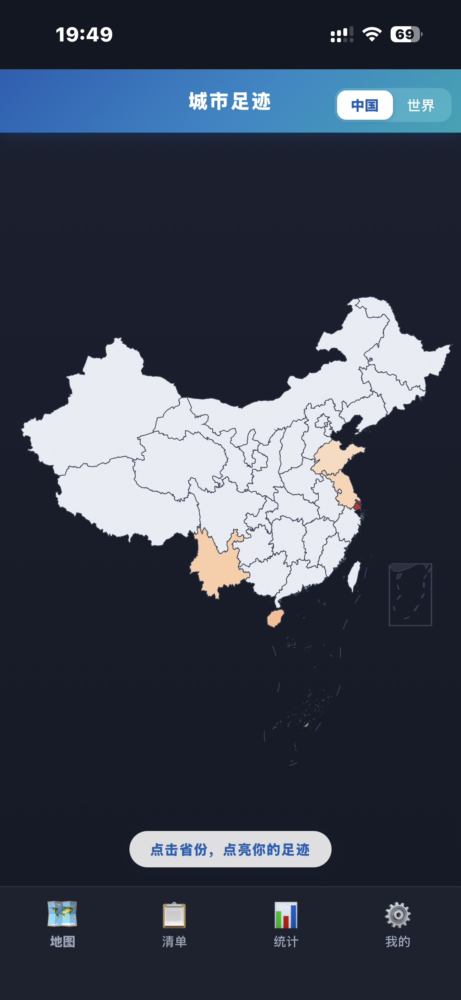
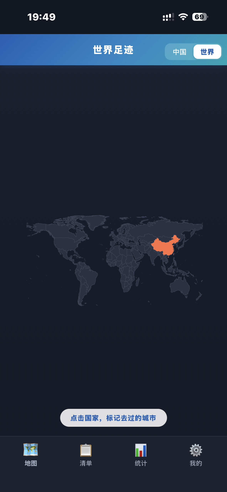
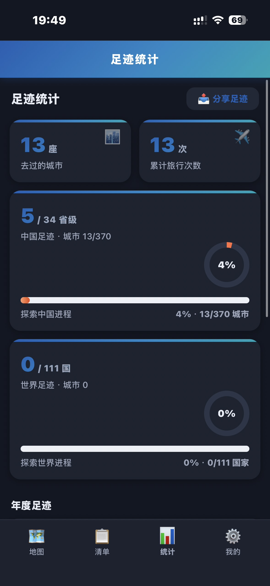

# 城市足迹（city-footprint）

> 把去过的每一座城市点亮在地图上，记下日期、次数、笔记和照片。
> 数据只存在你自己手机里，不上传任何服务器。

<p align="center">
  
  
  
</p>

<p align="center">
  <b>中国足迹</b> · 省份逐层钻取到城市　|　<b>世界足迹</b> · 按国家标记　|　<b>足迹统计</b> · 探索进度一目了然
</p>

## 这是什么

「城市足迹」是一个装在手机上的轻量 PWA（网页应用，可添加到主屏幕，像普通 App 一样使用，支持离线）。它只做一件事，并把它做好：**帮你把走过的地方变成一张会发光的地图**。

## 它能帮你做什么

- **地图点亮足迹**：在中国地图上点开省份、逐层钻取到城市，点一下「我去过这里」，这座城市就亮了；去过的城市越多，省份的颜色越饱满。世界地图则按国家标记你的足迹。
- **城市清单**：所有去过的城市按时间排列，支持搜索，随时补记、修改、删除。
- **足迹统计**：去过多少座城市、累计旅行多少次、中国探索进程（X/370 城市）、世界探索进程（X/111 国家）、年度足迹时间轴——用数字和进度条看清自己走过的路。
- **笔记与照片**：每座城市可以写一段笔记、存几张照片。照片压缩后存在本机，打开就能回看。
- **愿望清单**：还没去、但想去的地方，先用蓝色虚线描边记下来，它会在地图上静静等你。
- **足迹分享图**：一键生成「地图 + 统计」合成图片，发给朋友看看你的足迹版图。
- **备份与迁移**：导出 / 导入 JSON 备份，换手机、清浏览器都不怕丢。
- **离线可用**：安装后断网也能打开、查看、记录，有网时自动更新。

## 一点心意

地图上每亮起一座城，都是一段真实的抵达：一次出差路过的清晨、一场说走就走的旅行、一个生活过很多年的地方。这个 App 不联网、不要账号、不收集任何数据——你的足迹只属于你。愿它陪你把「去过」变成「记得」，也提醒你：世界很大，还有很多格子等着被点亮。

## 安装到手机

无需应用商店、无需开发者账号，打开部署链接后添加到主屏幕即可：

- **iPhone / iPad**：用 Safari 打开 → 点底部「分享」→「添加到主屏幕」
- **安卓**：用 Chrome 打开 → 点右上角「⋮」→「安装应用」或「添加到主屏幕」

## 数据来源

- 中国地图：高德 DataV GeoAtlas（含台湾省与南海诸岛）
- 世界地图：Natural Earth

## 技术栈

- 纯静态 PWA：原生 HTML/CSS/JS + ECharts 5.6.0（本地打包，无 CDN 依赖）
- PWA：manifest + Service Worker（核心预缓存 + 省级地图运行时缓存），全离线可用
- 数据边界：记录存 localStorage，照片存 IndexedDB，均为本机私有存储
- 构建工具：`tools/build_data.py`（数据加工）、`tools/make_icons.py` / `tools/make_maskable_icons.py`（图标生成）

## 目录结构

```
workspace-013/city-footprint/
├── src/                    # 源码（本地预览/构建源）
├── dist/                   # 构建产物（部署用）
│   ├── index.html
│   ├── app.js / styles.css / sw.js / manifest.webmanifest
│   ├── lib/echarts.min.js
│   ├── icons/              # PWA 图标（含 maskable 自适应图标）
│   └── assets/
│       ├── geo/china.json / world.json / city/{adcode}.json
│       └── data/destinations.json
├── tools/                  # 数据与图标构建脚本
├── tests/                  # 验收脚本与截图证据
└── docs/screenshots/       # 应用截图（本 README 使用）
```

## 本地开发

```bash
# 重新生成数据
python tools/build_data.py
# 本地预览（src 目录起任意静态服务）
cd src && python -m http.server 8080
```
